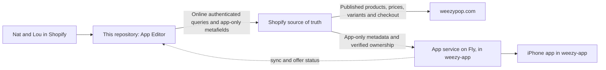

# Weezy Pop Shopify Admin

The independent source repository for **Weezy Pop App Editor**, used by Nat and Lou inside Shopify. Develop, test and release this editor here without building or releasing the iPhone app.

Extracted on 12 October 2026 as its own project ([provenance](docs/EXTRACTION.json)). It depends on no other repository: the metafield contract lives here in `contracts/`, and the iPhone app in [pete001/weezy-app](https://github.com/pete001/weezy-app) reads it.

## Start here

Read [AGENTS.md](AGENTS.md), [the Shopify contract](docs/SHOPIFY-CONTRACT.md) and [deployment instructions](docs/DEPLOYMENT.md). Use Node **24.19.0** and the committed npm lockfile.

```sh
npm ci
npm run verify
npm run preview
```

`verify` runs the editor and Shopify contract regression suites, TypeScript and the Shopify production extension build. These checks use injected requests and synthetic accounts, not live Shopify writes. No Xcode, other checkout, Fly credentials or Shopify login is required for them.

The preview opens at **http://127.0.0.1:48295**. Its changes are in memory and reset when restarted. It uses the actual editor components and public Shopify product photos with synthetic product/customer IDs. Shopify's Polaris script needs internet access. `npm run dev` is different: it uses authenticated Shopify development tooling and requires an explicitly selected test store.

**Pull requests:** every change to `main` goes through a PR, merged by squash once the `editor` check (`npm run verify` in CI) is green; GitHub enforces both. Dependabot opens weekly update PRs for npm and GitHub Actions. Merging never deploys: releasing the editor to Shopify is a separate `npm run deploy` that needs the owner's go-ahead (see [deployment](docs/DEPLOYMENT.md)).

## What the editor manages

| Section | Staff task |
|---|---|
| Start here | To do: what needs doing, counted from Shopify (purchases waiting, sets that need attention, charms without a cut-out or story, products to check), each opening its list filtered to what's left with its progress; then every tool |
| Product photos | Choose the app cover, order and hide photos without changing the website gallery; add the charm's transparent cut-out (a Shopify Files link) for the set chain |
| Match finish photos | Match exact Shopify variants to visible photos using image previews |
| Charm stories | Write compact app-only copy, retaining the website description |
| App catalogue | Set app visibility and category, including reviewed bulk changes |
| Curated sets | Maintain membership, repeated quantities, permitted variants, offers and badge artwork |
| Display order | Set the app's product order within its sections |
| Review purchases | Approve or decline customer registrations of outside-app purchases |
| Add outside purchases | Record or revoke verified staff-entered ownership for a customer |

Staff open [Apps → Weezy Pop App Editor](https://admin.shopify.com/store/weezypopshop/apps/weezy-pop-app-editor) using their Shopify staff account. This is a Shopify-hosted `admin.app.home.render` extension. There is no separate admin password, Fly admin website or production server in this repository.

## Customer account review blocks

The same app also carries a small customer-facing extension, `extensions/account-reviews` (**Account reviews**), on Weezy Pop's customer accounts. It reads the signed-in customer's own orders through the Customer Account API and never writes anything. It sends customers to their order page, where Judge.me's verified "Write a new review" form is; it never links to Judge.me or calls its API. To know which pieces are already reviewed, it asks the app service (`GET /v1/account/reviewed`, with the customer's Shopify session token), which asks Judge.me; the service URL comes from `extensions/app-images/src/app-service.mjs`.

| Target | Customers see |
|---|---|
| Orders page block (`customer-account.order-index.block.render`) | "Loving your new sparkle?": every delivered piece not yet reviewed (from the last 50 orders, any date), up to 12 with a line counting the rest, each with a REVIEW button to its order page. If the app service cannot say what is reviewed (down, over 5 seconds, or an odd answer), it falls back to up to six pieces from orders placed in the last 60 days and since fulfilled |
| Order page block (`customer-account.order-status.block.render`) | "Your sparkle, your say" and the photos of the order's pieces not yet reviewed, once the order is fulfilled, placed above Judge.me's "Write a new review"; nothing once every piece is reviewed |

All customer words are in `extensions/account-reviews/src/copy.mjs`; which pieces show is decided in `pieces.mjs` (gift cards, cancelled orders and the £0 product options helper lines are left out) and the reviewed set is read in `reviewed.mjs`. It needs the `customer_read_orders` scope, the `network_access` capability (granted for the app in the Dev Dashboard) and protected customer data access, which take effect only on an authorized deploy; placing the blocks is a separate step in Shopify admin. [Post-deploy steps](docs/DEPLOYMENT.md#customer-account-review-blocks).

## How this connects to the app



The editor writes `charm_club` metafields. The app service and the iPhone app (both in pete001/weezy-app) consume them; the editor reads two status endpoints back from the app service (see `extensions/app-images/src/app-service.mjs`). Website product photos, prices, variants, collections, themes, stock and discounts remain outside the editor's write scope. Shopify still owns every product and variant identity, price and availability.

Changes to existing metadata values reach the app after the app service's cache refresh, currently up to five minutes, followed by app refresh. Changes to field schemas, offer rules or ownership semantics change the contract in `contracts/`: ship the matching reader change in weezy-app first. [Contract and ownership](docs/SHOPIFY-CONTRACT.md).

## Repository layout

```text
extensions/app-images/src/  Shopify UI, workflows and fallback content
extensions/account-reviews/ Customer account review blocks (read-only, own tsconfig)
contracts/                 The charm_club metafield contract (validators, editors, readers) and its tests
assets/                    Existing admin app icon and branding
fixtures/                  Synthetic catalogue and synthetic proof image
qa/preview.mjs             Local in-memory editor preview
shopify.app.toml           Existing App Editor identity and approved scopes
.github/workflows/verify.yml Independent CI; no deployment or signing secrets
```

The `contracts` modules are the canonical, versioned definition of the metafields. pete001/weezy-app takes its copy from here. [Extraction provenance](docs/EXTRACTION.json) records where they came from. Public customer data, private keys, CLI caches, production databases and live bulk-publishing scripts are excluded.

## Working and releasing independently

Create a feature branch, make the smallest admin change, run `npm run verify` and review the affected workflow. CI checks pull requests and `main` on an isolated hosted runner. It never deploys or gets Shopify credentials.

The same installed App Editor client ID and extension UID are retained, so an authorized deployment updates the existing app. Do not create a replacement app, increase scopes or deploy to any other app. The one deliberate addition is `customer_read_orders`, for the customer account review blocks. [Deployment checklist](docs/DEPLOYMENT.md).

[Current code review](docs/CODE-REVIEW-2026-10-26.md): all88 tests, strict typecheck and production build pass. Three Dependabot updates are merged; the [current audit](docs/DEPENDENCY-AUDIT.md) has0 findings. Preact11 remains held for its draft-navigation regression.
