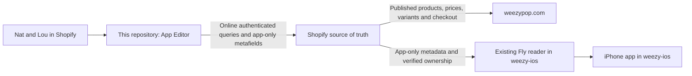

# Weezy Pop Shopify Admin

The independent source repository for **Weezy Pop App Editor**, used by Nat and Lou inside Shopify. Develop, test and release this editor here without building or releasing the iPhone app.

Extracted on 12 October 2026 from the tested mobile checkout at `632fd06c0224479af3b76b4451ff5c8aebaceabb`. This migration publishes source only. It does not deploy an extension, change staff access or save any Shopify data.

## Start here

Read [AGENTS.md](AGENTS.md), [the Shopify contract](docs/SHOPIFY-CONTRACT.md) and [deployment instructions](docs/DEPLOYMENT.md). Use Node **24.19.0** and the committed npm lockfile.

```sh
npm ci
npm run verify
npm run preview
```

`verify` runs the editor and Shopify contract regression suites, TypeScript and the Shopify production extension build. These checks use injected requests and synthetic accounts, not live Shopify writes. No Xcode, Swift source, mobile checkout, Fly credentials or Shopify login is required for them.

The preview opens at **http://127.0.0.1:48295**. Its changes are in memory and reset when restarted. It uses the actual editor components and public Shopify product photos with synthetic product/customer IDs. Shopify's Polaris script needs internet access. `npm run dev` is different: it uses authenticated Shopify development tooling and requires an explicitly selected test store.

## What the editor manages

| Section | Staff task |
|---|---|
| Start here | Choose the right tool and see outstanding app tasks |
| Product photos | Choose the app cover, order and hide photos without changing the website gallery |
| Match finish photos | Match exact Shopify variants to visible photos using image previews |
| Charm stories | Write compact app-only copy, retaining the website description |
| App catalogue | Set app visibility and category, including reviewed bulk changes |
| Curated sets | Maintain membership, repeated quantities, permitted variants, offers and badge artwork |
| Display order | Set the app's product order within its sections |
| Review purchases | Approve or decline customer registrations of outside-app purchases |
| Add outside purchases | Record or revoke verified staff-entered ownership for a customer |

Staff open [Apps → Weezy Pop App Editor](https://admin.shopify.com/store/weezypopshop/apps/weezy-pop-app-editor) using their Shopify staff account. This is a Shopify-hosted `admin.app.home.render` extension. There is no separate admin password, Fly admin website or production server in this repository.

## How this connects to the app



The editor writes `charm_club` metafields. The native app and existing Fly service consume them. Website product photos, prices, variants, collections, themes, stock and discounts remain outside the editor's write scope. Shopify still owns every product and variant identity, price and availability.

Changes to existing metadata values can reach the app after its reader cache refresh, currently up to five minutes, followed by app refresh. Changes to field schemas, offer rules or ownership semantics need a coordinated reader change in `weezy-ios`; releasing this editor alone cannot update Swift or Fly code. [Compatibility and ownership](docs/SHOPIFY-CONTRACT.md).

## Repository layout

```text
extensions/app-images/src/  Shopify UI, workflows and fallback content
contracts/                 Extracted Shopify editor logic and reader compatibility tests
assets/                    Existing admin app icon and branding
fixtures/                  Synthetic catalogue and synthetic proof image
qa/preview.mjs             Local in-memory editor preview
scripts/check-contracts.mjs Optional read-only comparison with a mobile checkout
shopify.app.toml           Existing App Editor identity and approved scopes
.github/workflows/verify.yml Independent CI; no deployment or signing secrets
```

The `contracts` modules are a versioned snapshot, not an npm dependency on the mobile project. [Extraction provenance](docs/EXTRACTION.json) records the original file hashes and adaptations. Two tests for the mobile HTTP router remain in the mobile repository; their editor/validation cases are retained here. Public customer data, private keys, CLI caches, production databases and live bulk-publishing scripts are excluded.

## Working and releasing independently

Create a feature branch, make the smallest admin change, run `npm run verify` and review the affected workflow. CI checks pull requests and `main` on an isolated hosted runner. It never deploys or gets Shopify credentials.

The same installed App Editor client ID and extension UID are retained, so an authorized deployment updates the existing app. Do not create a replacement app, increase scopes or deploy to the iOS reader app. [Deployment checklist](docs/DEPLOYMENT.md).

The copy in `weezy-ios/shopify-image-editor` is a frozen compatibility snapshot for older service tests and historical evidence. This repository owns future admin development. Keep schema changes coordinated; do not maintain two competing editor implementations.

[Dependency audit follow-up](docs/DEPENDENCIES.md): the inherited lockfile currently has11 audit findings. Production build/tests pass; no major Shopify downgrade was applied during extraction.
